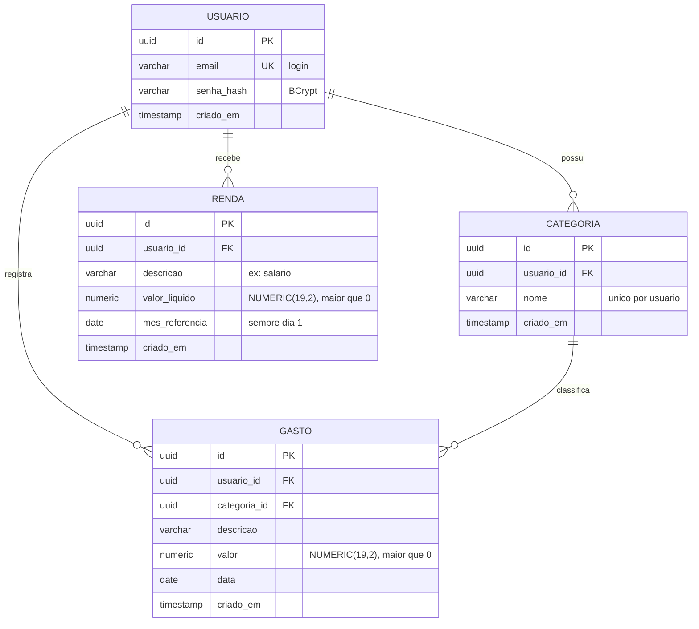

# Soldi App - MVP v1

Primeira versão do sistema: registrar gastos e renda e consultar quanto sobrou no mês.

## 1. Funcionalidades

| ID | Funcionalidade | Detalhe |
| --- | --- | --- |
| F01 | Cadastrar usuário | E-mail e senha. A senha é armazenada com hash (BCrypt). |
| F02 | Login | E-mail e senha retornam um token JWT. Todas as demais funcionalidades exigem o token. |
| F03 | Categorias | Criar, listar, editar e excluir categorias próprias (apenas nome). |
| F04 | Gastos | Registrar, listar, editar e excluir gastos com descrição, valor, data e categoria. A listagem filtra por mês. |
| F05 | Renda | Registrar, listar, editar e excluir a renda do mês (salário **líquido**) com descrição, valor e mês de referência. |
| F06 | Resumo do mês | Para um mês escolhido: renda líquida, total de gastos, sobra e total gasto por categoria. |

## 2. Regras

1. Cada usuário acessa e altera somente os próprios dados.
2. Valor de gasto e de renda é maior que zero, com duas casas decimais.
3. Todo gasto tem uma categoria.
4. Categoria que já possui gastos não pode ser excluída.
5. O nome da categoria é único por usuário.
6. Sobra = renda líquida do mês − total de gastos do mês. Pode ser negativa.
7. O mês é o mês de calendário. Um mês pode ter mais de uma renda; o resumo soma todas.
8. Valores monetários usam `BigDecimal` no Java e `NUMERIC(19,2)` no Postgres.

## 3. Fora da v1

Salário bruto e descontos, gasto fixo e variável, diagnóstico financeiro, contas bancárias, transferências, cartão de crédito, parcelas, importação de extrato e CPF.

O CPF fica fora por LGPD: não se coleta o dado que o sistema não precisa.

## 4. Modelo de dados

### Notas de modelagem

- `usuario_id` fica em GASTO e RENDA, mesmo com GASTO alcançando o usuário pela categoria. Toda consulta filtra direto pelo dono, sem depender de join.
- O resumo não é tabela. É calculado a partir de GASTO e RENDA, então não fica desatualizado.
- `mes_referencia` é uma data no dia 1, o que reduz o filtro do mês a uma comparação simples.
- Várias rendas no mesmo mês são permitidas (salário e extras) sem entidade adicional.
- Chaves primárias são UUID.
- Evolução prevista para salário bruto e descontos: RENDA ganha `valor_bruto` (opcional) e surge a tabela DESCONTO_RENDA (renda_id, tipo, valor). Nada do modelo acima precisa ser desfeito.

