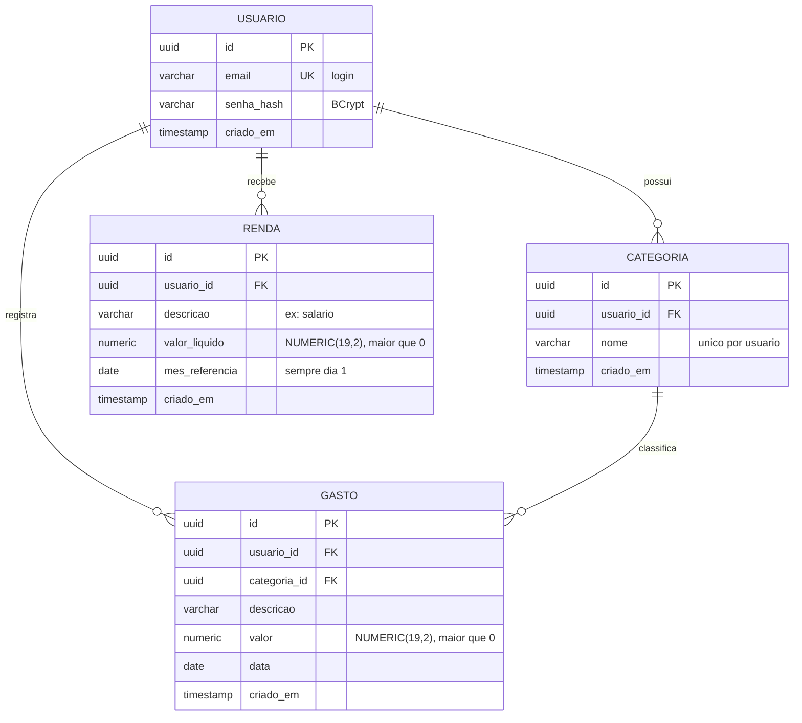

# Soldi App - MVP v1

Primeira versão do sistema: registrar gastos e renda e consultar quanto sobrou no mês.

## 1. Funcionalidades

| ID | Funcionalidade | Detalhe |
| --- | --- | --- |
| F01 | Cadastrar usuário | E-mail e senha. A senha é armazenada com hash (BCrypt). |
| F02 | Login | E-mail e senha retornam um token JWT. Todas as demais funcionalidades exigem o token. |
| F03 | Categorias | Criar, listar, editar e excluir categorias próprias (apenas nome). |
| F04 | Gastos | Registrar, listar, editar e excluir gastos com descrição, valor, data e categoria. A listagem filtra por mês. |
| F05 | Renda | Registrar, listar, editar e excluir a renda do mês (salário **líquido**) com descrição, valor e mês de referência. |
| F06 | Resumo do mês | Para um mês escolhido: renda líquida, total de gastos, sobra e total gasto por categoria. |

## 2. Regras

1. Cada usuário acessa e altera somente os próprios dados.
2. Valor de gasto e de renda é maior que zero, com duas casas decimais.
3. Todo gasto tem uma categoria.
4. Categoria que já possui gastos não pode ser excluída.
5. O nome da categoria é único por usuário.
6. Sobra = renda líquida do mês − total de gastos do mês. Pode ser negativa.
7. O mês é o mês de calendário. Um mês pode ter mais de uma renda; o resumo soma todas.
8. Valores monetários usam `BigDecimal` no Java e `NUMERIC(19,2)` no Postgres.

## 3. Fora da v1

Salário bruto e descontos, gasto fixo e variável, diagnóstico financeiro, contas bancárias, transferências, cartão de crédito, parcelas, importação de extrato e CPF.

O CPF fica fora por LGPD: não se coleta o dado que o sistema não precisa.

## 4. Modelo de dados

### Notas de modelagem

- `usuario_id` fica em GASTO e RENDA, mesmo com GASTO alcançando o usuário pela categoria. Toda consulta filtra direto pelo dono, sem depender de join.
- O resumo não é tabela. É calculado a partir de GASTO e RENDA, então não fica desatualizado.
- `mes_referencia` é uma data no dia 1, o que reduz o filtro do mês a uma comparação simples.
- Várias rendas no mesmo mês são permitidas (salário e extras) sem entidade adicional.
- Chaves primárias são UUID.
- Evolução prevista para salário bruto e descontos: RENDA ganha `valor_bruto` (opcional) e surge a tabela DESCONTO_RENDA (renda_id, tipo, valor). Nada do modelo acima precisa ser desfeito.

## 5. Histórias de usuário — F04 Gastos (para testar no Postman)

Base: `POST/GET/PUT/DELETE /gasto`, sempre com header `Authorization: Bearer <token>` (login em `POST /auth/login`). Payload de criação/edição: `{ "idCategoria": "<uuid>", "descricao": "string até 255", "valor": 0.00, "data": "AAAA-MM-DD" }`.

Já testadas por você: valor ≤ 0 rejeitado (`HU-04.03`) e categoria ausente ou de outro usuário rejeitada (`HU-04.04`/`HU-04.05`). As demais abaixo são as que faltam.

### Cadastro (`POST /gasto`)

- **HU-04.01 — Cadastrar gasto com dados válidos.** Como usuário autenticado, quero registrar um gasto com categoria, descrição, valor e data para acompanhar meus gastos do mês.
  - Dado um token válido e uma categoria que pertence ao usuário, quando enviar `idCategoria`, `descricao`, `valor` (ex.: `150.50`) e `data` válidos, então a API retorna `201` com o gasto criado, incluindo `idGasto` e `idUser` do usuário autenticado.
- **HU-04.02 — Rejeitar categoria inexistente.** Como usuário, não quero conseguir cadastrar um gasto com um `idCategoria` que não existe em lugar nenhum (UUID aleatório).
  - Dado um `idCategoria` que não existe, quando cadastrar o gasto, então a API retorna erro de categoria não encontrada (distinto do caso "categoria de outro usuário").
- ✅ HU-04.03 — valor ≤ 0 rejeitado (já testada).
- ✅ HU-04.04 / HU-04.05 — categoria obrigatória e categoria de outro usuário rejeitada (já testadas).
- **HU-04.06 — Rejeitar valor com mais de 2 casas decimais.** Como usuário, quero que o sistema recuse um valor como `150.555` para manter a consistência monetária.
- **HU-04.07 — Rejeitar descrição ausente ou em branco.**
  - Dado `descricao` nula, vazia ou só espaços, quando cadastrar, então a API rejeita com mensagem "A descrição é obrigatória.".
- **HU-04.08 — Rejeitar descrição com mais de 255 caracteres.**
- **HU-04.09 — Rejeitar data ausente.**

### Consulta (`GET /gasto/{id}`, `GET /gasto`, filtros)

- **HU-04.10 — Buscar gasto por ID com sucesso.** Como usuário, quero consultar um gasto específico meu pelo ID.
- **HU-04.11 — Isolamento: não encontrar gasto de outro usuário.** Como usuário, não quero conseguir ver um gasto que pertence a outro usuário, mesmo sabendo o ID.
  - Dado o ID de um gasto cadastrado pelo usuário B, quando o usuário A buscar esse ID com o próprio token, então a API retorna "Gasto não encontrado" (não deve expor que o gasto existe).
- **HU-04.12 — Buscar gasto inexistente retorna não encontrado.**
- **HU-04.13 — Listar todos os gastos do usuário autenticado.** Retorna página (20 itens, ordenada por data decrescente) só com gastos do próprio usuário.
- **HU-04.14 — Listar gastos filtrando por valor exato.**
- **HU-04.15 — Listar gastos filtrando por categoria.**
  - Dado um `idCategoria` de outro usuário, quando filtrar por essa categoria, então a API rejeita como categoria não encontrada (mesma regra de isolamento do cadastro).
- **HU-04.16 — Listagem nunca mistura gastos de usuários diferentes.** Como usuário, quero ter certeza de que, cadastrando gastos em duas contas diferentes, a listagem de uma conta nunca mostra o gasto da outra.
  - Nota: a regra do MVP ("listagem filtra por mês") ainda não tem filtro por mês implementado — hoje só existem filtro por valor e por categoria. Vale testar como está e registrar a divergência.

### Edição (`PUT /gasto/{id}`)

- **HU-04.17 — Editar gasto com sucesso.** Como usuário, quero corrigir descrição, valor, data ou categoria de um gasto já cadastrado.
- **HU-04.18 — Rejeitar edição com valor ≤ 0.** Mesma regra do cadastro, aplicada na atualização.
- **HU-04.19 — Rejeitar edição de gasto de outro usuário.**
- **HU-04.20 — Rejeitar edição de gasto inexistente.**
- **HU-04.21 — Trocar a categoria do gasto na edição.** Como usuário, quero mover um gasto para outra categoria minha.
  - Atenção ao testar: vale checar o comportamento quando a nova categoria enviada pertence a outro usuário (deveria rejeitar).

### Exclusão (`DELETE /gasto/{id}`)

- **HU-04.22 — Excluir gasto com sucesso.** Retorna `204` e o gasto some da listagem.
- **HU-04.23 — Rejeitar exclusão de gasto de outro usuário.**
- **HU-04.24 — Rejeitar exclusão de gasto inexistente.**
